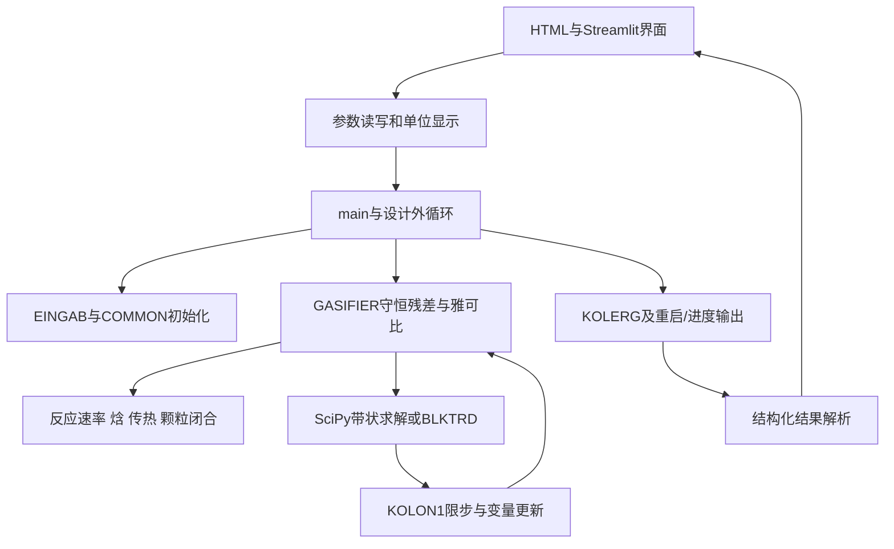

# 1. 模块、状态与变量字典

[手册首页](README.md) · [下一章：执行流程](02_CALL_HIERARCHY.md)

## 1.1 模型边界与分层

计算域是燃烧室加可选辐射废锅；物料由第1格向更大格号流动。各格用出口气体组分流量、总固体流量、固体碳质量分数与温度表示。压力PWK为给定全炉常量，没有压力降未知量；气速由理想气体体积流量与截面积求得。固体速度和停留时间是附属闭合，不独立求解完整动量守恒。

界面和后端不拥有另一套物理模型。它们修改输入文件、启动核心、解析同次输出。外层设计重复调用完整内层计算；不能仅修改显示温度或产汽数字。

## 1.2 模块职责和Fortran来源

| 当前模块 | 来源/定位 | 主要责任 |
|---|---|---|
| [main.py](../../src/main.py) | Wg1.for | 文件生命周期、模式分派、内层迭代、退出码 |
| [common_data.py](../../src/common/common_data.py) | Common.00–03 | 共享可变状态、数组分配与原位重置 |
| [physical_constants.py](../../src/common/physical_constants.py) | 新增 | 按炉型选择一致的原子量/摩尔质量和物理常数 |
| [initialization.py](../../src/subroutines/initialization.py) | Wg2.for | 解析输入、检查、几何、进料、挥发分、热校正、初值 |
| [gasifier_main.py](../../src/subroutines/gasifier_main.py) | Wg3.for | 11个残差、局部扰动、A/B/C块和-R |
| [mass_flow.py](../../src/subroutines/mass_flow.py) | XMASS | 密度代理、颗粒速度、停留时间、持料量 |
| [gas_reactions.py](../../src/functions/gas_reactions.py) | Wg6.for | XK1–6和煤挥发分分配FLUCHT |
| [reaction_rates.py](../../src/functions/reaction_rates.py) | Wg7.for；TPAR参照Wg8 | A1–5、传质、焓、辐射和辅助物性 |
| [fh2o_fortran.py](../../src/functions/fh2o_fortran.py) | Wg7的旧水表 | 反应侧水物性、历史焓基准 |
| [output_results.py](../../src/subroutines/output_results.py) | Wg8.for | ENTFED、ENTKOL、KOLERG、START、诊断 |
| [math_utils.py](../../src/functions/math_utils.py) | Wg9.for及新增SciPy封装 | 线性代数、牛顿限步和收敛监测 |
| [steam_props.py](../../src/functions/steam_props.py) | 新增IF97封装 | 汽包/给水水侧焓、饱和温度、产汽 |
| [feed_design.py](../../src/functions/feed_design.py) | 新增 | 燃烧室温度/有效气量双目标反算 |
| [rsc_design.py](../../src/functions/rsc_design.py) | 新增 | 废锅目标温度求有效高度 |
| [web_backend](../../web_backend/app.py) | Flask | 单进程任务锁、子进程、参数/结果API |

Fortran对应是移植来源说明；本轮没有重新编译和重新验证全部原Fortran文件。原始资料位于`fortran_base/`，数值对照工具位于`numeric_test/`。

## 1.3 COMMON状态及生命周期

`CommonData`为单例；模块通过`from common.common_data import common`共享引用。`reset()`清空原对象的属性并重新初始化，**不重新绑定一个新common对象**。因此其他模块持有的引用仍有效。

一次候选计算的状态流：默认值 → 输入覆盖 → 统一常数 → 校验 → 几何和源项 → 初值 → 牛顿更新 → 最终派生量刷新。运行时修改KMODEL不能只改一个整数：必须重新调用EINGAB，否则质量表、网格和源项可能不一致。

COMMON不是线程安全的模型上下文。单进程内不得并行求两个候选；测试用多个独立进程、独立工作目录隔离。Flask锁只保护同一个服务进程中的任务，不覆盖另一个服务或手动CLI。

## 1.4 索引规则

- 格子：`i=1..NZRE`；燃烧室1..30，RSC为31..30+N_RSC。
- `NZDIM=61`是存储容量，非有效格子数；最大60格。0号格通常闲置。
- 组分/方程索引：1..8气体，9总固体，10残碳方程，11能量方程。
- `FEMF[j,i]`按“组分、格子”排列，不能误转置。
- **例外：`XMOL`是0-based的10项表**，依次为8种气体、C、SiO₂灰代理；`XMOL[j-1]`对应气体j。
- 物性函数的形参`X`通常是历史干度/状态占位，不等于`common.X[i]`。`Y[1:9]`是当前局部临时摩尔分数，不保存全炉组成。

| j | 气体 | 质量属性 | FEMF单位 |
|---:|---|---|---|
| 1 | O₂ | MO2 | kmol/s |
| 2 | CH₄ | MCH4 | kmol/s |
| 3 | CO | MCO | kmol/s |
| 4 | CO₂ | MCO2 | kmol/s |
| 5 | H₂S | MH2S | kmol/s |
| 6 | H₂ | MH2 | kmol/s |
| 7 | N₂ | MN2 | kmol/s |
| 8 | H₂O | MH2O | kmol/s |

## 1.5 核心变量字典

| 代码变量 | 物理含义/计算 | 单位/形状 |
|---|---|---|
| FEMF[j,i] | 格子出口组分摩尔流量 | kmol/s；(9,61) |
| WE[i] | 总固体流=残碳+灰 | kg/s；(61,) |
| X[i] | 出口固体中的碳质量分数 | 0–1；(61,) |
| T[i] | 格子温度未知量 | K；(61,) |
| FEM[i] | ΣFEMF[1:9,i] | kmol/s |
| U0[i] | FEM·RAG·T/(PWK·AT) | m/s，表观气速 |
| US[i], TRZ[i] | 颗粒速度、单格停留时间 | m/s、s |
| XMS[i] | WE·TRZ，单格固体持料量 | kg，不是质量流量 |
| ROS[i], ROG[i] | 固体密度、历史气体密度代理 | kg/m³ |
| XMUG[i], EPS[i] | 动力粘度、1−固体体积/格子体积 | Pa·s、无量纲 |
| DELZ[i], AT[i], AR[i] | 轴向长度、截面积、壁面周长 | m、m²、m |
| H[i] | 旧几何位置字段，非连续沿程累计距离 | m；详见第3章 |
| HREAK | 仅燃烧室总长8.3604 m | m，不包含H_RSC |
| BSMS | BSLURRY·RATIO_COAL，输入煤流 | kg/s，含输入煤内水 |
| BSWAF | BSMS·(1−ELAS−ELH2O) | kg/s，无水无灰煤 |
| WFC[i], WFA[i] | 热解后固定碳、灰外部源项 | kg/s |
| FEEDO2/FEEDN2/FEDCO2/FEDH2O | 外部气体/水源项 | kmol/s |
| RVCH4/RVH2/RVH2O/RCO/RCO2/RVTAR | 热解伪分配源项 | kmol/s |
| RH2/RO2/REN2/RH2S | 元素余量补足源项 | kmol/s |
| XCVM0 | 挥发释放总质量/BSWAF | 反应核模型使用的派生比例 |
| XC0 | ΣWFC/(ΣWFC+BSMS·ELAS) | 热解后固体初始碳分数 |
| HENTH[1:9,i] | 气相含生成焓的摩尔焓 | J/kmol |
| HENTH[9:11,i] | C和灰的质量比焓 | J/kg |
| DHDT | 温度加1 K的焓差 | 对应焓单位/K |
| FEEDH[1:4,i] | O₂、N₂、CO₂进料焓槽 | J/kmol；CO₂槽有历史问题 |
| FEDPH[1:3,i], HFH2O[i] | C/灰进料比焓、水进料摩尔焓 | J/kg、J/kmol |
| QKW[i] | 壁面取热，正数表示从气侧移出 | W |
| QLOSS | 燃烧室附加热损失比例 | 无量纲 |
| QH_CRCT | 旧热校正标量，在能量行作为功率项使用 | 存在单位疑点，见第7、9章 |
| RAC[i] | 组装时保存的碳反应质量速率 | kg/s；输出辅助诊断可能滞后一轮 |

## 1.6 方程工作区

每格向量为`[nO2,nCH4,nCO,nCO2,nH2S,nH2,nN2,nH2O,W,X,T]`。正常11变量，60格时660未知数。

| 数组 | 分配形状 | 有效范围/语义 |
|---|---|---|
| AMAT/BMAT/CMAT | (13,13,61) | 方程/变量1..11；下/主/上对角块 |
| DMAT | (13,61) | 先R，后−R，线性求解后Δu；不能脱离阶段解释 |
| HENTH/DHDT | (16,61) | 当前使用1..10；较大容量不等于更多气体组分 |
| FEEDH/FEDPH | (4,61)/(3,61) | 同样保留0号槽 |

AMAT块索引有一格偏移：`AMAT[:,:,i-1]`作用于第i行块中的上游未知量。CMAT当前组装为零，接口仍支持一般块三对角系统，见第8章。

## 1.7 三种不同的“碳转化率”相关量

1. 求解变量`X`：残碳/总固体；通常越小表示残碳越少。
2. 内部分布表的`X(%)`：实际输出`100·[1−FASH·X/(1−X)]`，FASH=ELAS/(ELC+ELH+ELO+ELN+ELS)。它是历史模型的转化指标，不是common.X×100。
3. 最终`CarbonConversion`：`1−WE_out·X_out/(BSMS·ELC)`，以煤中元素碳为分母。外加CO₂不加入这个分母。

内部表标题“碳流量”当前实际打印WE总固体，详见第5、9章。阅读历史输出时必须按表达式判定物理量，不能仅凭列名。
