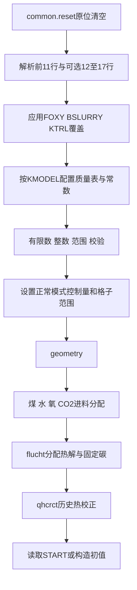
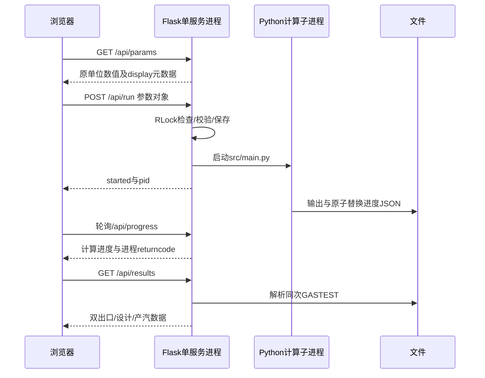

# 2. 执行流程与调用关系

[手册首页](README.md) · [变量字典](01_MODULE_OVERVIEW.md)

## 2.1 入口与文件生命周期

`python src/main.py`调用`main()`，不解析额外命令行工况参数；使用其他输入应从Python调用`main(data_path)`或使用隔离测试驱动。

`main`先写初始化进度，再以UTF-8覆盖打开当前工作目录的GASTEST.DAT。随后`_run`调用EINGAB，将初始条件先写入StringIO。读取文件与模型的输入路径基于项目根目录；输出、START和进度相对于当前工作目录。因此路径隔离必须同时处理“输入绝对路径”和“工作目录”。

模式分派顺序：FEED_MODE优先；若为1，交给进料反算，内部再判断RSC_MODE；否则RSC_MODE=1调用高度设计；两个模式都0才直接正算。这样联合模式不会先用原进料搜索废锅高度。

返回0表示内层收敛并满足所有启用目标；2表示数值/设计失败；异常写error进度后重新抛出。不能把HTTP启动成功、进程结束或输出文件存在等同于计算成功。

## 2.2 初始化的依赖顺序

详细过程：

1. 最少11行，按逗号切数值，首个`/`之后为注释；识别D/d指数。
2. 每行数量和控制整数在赋值前检查。缺失可选行采用本次reset后的默认值，不能继承上次炉型。
3. 反算覆盖只允许FOXY、BSLURRY、KTRL；覆盖必须发生在任何源项重建之前。
4. `configure(common)`统一本次质量基准。校验时把内部`PFEED_OX/TFEED_OX`映射到外部`PFEED_O2/TFEED_O2`名称。
5. 正常入口强制KCHECK=0、KTRLT=1、KTRLR=1；固定燃烧室30格和一次进料/挥发分第1格；二次氧第7格。
6. `geometry()`刷新DELZ、H、AT、AR和分配区长度。随后构造外部源项，FLUCHT会覆盖WFC，使其从“煤中总碳”变为“热解后固定碳”。
7. 反算模式强制KTRL=1，后续复用仅来自本次已收敛候选。普通KTRL=0优先读工作目录START，缺失则读输入同目录。
8. 初始组成与温度只是牛顿起点。默认RSC温度线性初猜不代表指定了最终出口温度，也不代表初值已经守恒。

## 2.3 一次内层牛顿迭代

`_iterate`每次候选将ITERAT置零并重置矩阵，然后重复：

1. `gasifier(...)`组装当前状态的残差及雅可比。
2. 第一次组装输出前5格矩阵片段到python_matrix_iter0.txt；这个文件不是全660×660矩阵。
3. `newtra(omega=1)`按炉型/环境变量选择SciPy或BLKTRD，写回DMAT=Δu。
4. `kolon1`先用未限幅修正量判断阈值，再限步并更新未知量。
5. `calculate_residuals()`再次汇总同一DMAT，写收敛历史与进度。
6. KONVER=0则KOLERG输出；到ITMAX则输出诊断并返回2。

数值差分的调用链：`gasifier → _calculate_dmat_for_cell → xmass / entfed / entkol → XK / A / RI / PHI / ENTHP / WDKR`。`RI`内部会再次调用A1–A4；当前没有把所有反应速率统一缓存。

组装阶段的ENTKOL缓存只存活一轮GASIFIER；键为(T,PWK)，保存十种组分的焓与温度差分。ENTFED原生实现一轮只调用一次。XMASS不能任意缩成仅本格更新：入口固体体积流依赖上游密度。

## 2.4 组装结束与输出刷新不同

数值扰动会临时更新Y、焓、持料量等。GASIFIER恢复主未知量，但不能把最后一次扰动后的全部派生字段直接作为最终结果。KOLERG因此重新计算全炉FEM、U0、QKW、XMASS和ENTKOL。

KOLERG之后可读同次湿气摩尔流量与灰量；元素审计用完整状态FEMF/WE/X，不用打印到3–6位的表格。RAC辅助速率未做同等完整的最终重算，不应作为独立验收真值。

## 2.5 进料设计调用链

`run_feed_design → search_feed → evaluate(FOXY,BSLURRY)`。每个evaluate都重新EINGAB，重建进料与热源；候选初值取本轮历史收敛状态中**对数进料距离最近**的一组，将气/固流量按负荷比缩放，X和T沿用。它不是只取最后一个候选，也不是跳过内层收敛。

搜索器保留已接受候选；扰动或回溯试算可能使COMMON停在别的状态，finish必要时重新计算最佳已接受候选，最多额外一次。输出头和最终状态必须来自同一个候选。

若同时启用RSC设计，先求燃烧室双目标，再以反算进料搜索高度。`finalize=False`延迟START与终态写入，最后复核燃烧室双目标，以overall_success决定是否接受。

## 2.6 废锅设计调用链

`run_target_design → search_height → evaluate(height)`。候选设置H_RSC并调用geometry，沿用前一高度的当前状态作为初值，仍完整求全炉。每个候选从同一状态获得出口温度、Q_RSC和IF97产汽量。目标成功才由设计层调用write_start。

搜索内层输出使用StringIO，最终GASTEST通常保留最后候选的详细迭代表；外层全部轨迹存入RSC_DESIGN_JSON/FEED_DESIGN_JSON。不能通过最终迭代表行数推断整个设计总耗时/总迭代数。

## 2.7 Web任务时序

`_serialized_write`用同一RLock串行化参数写入和启动。计算中返回409；非法参数返回400。stdout/stderr落盘避免管道缓冲区塞满。多个worker各有自己的锁，不能因此支持并发共用目录。

## 2.8 Streamlit与打包路径

普通Streamlit使用子进程和文件通信；打包后sys.executable指向程序自身，因此用后台线程直接调用核心。打包路径会临时改变进程工作目录并接管stdout/stderr；不适合并行多会话计算。直接线程句柄的terminate没有强制终止实现，不应承诺按钮可以安全中断任意内层计算。

两套界面共享核心、单位换算和部分结果兼容工具，但各有参数/表格逻辑。Web支持前17行，Streamlit仍只编辑前11行并保留扩展。

## 2.9 重启写入的实际边界

设计候选和失败设计不会写START；**普通正算达到ITMAX时，当前实现仍调用KOLERG(write_restart=True)**。write_start自身不检查KONVER，也会将写入失败作为警告输出。故应保存已接受重启副本，并用退出码/最终目标状态验收。本轮整理将此行为记录为待修问题，未暗中改变数值流程。
